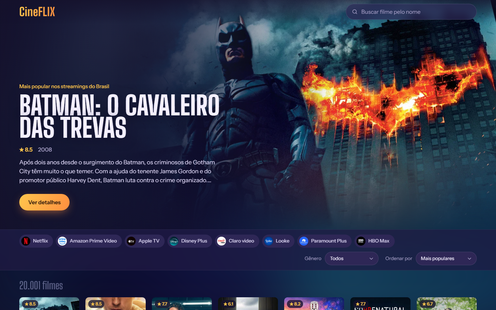

# CineFLIX — Catálogo de Filmes em Streaming

[](https://github.com/carlosandreest55/CineFLIX/actions/workflows/testes.yml)

Um site que mostra os filmes disponíveis nos streamings por assinatura no Brasil (Netflix, Prime Video, Disney+...), com filtros por streaming e gênero, busca por nome e detalhes de cada filme. Os dados vêm do [TMDB](https://www.themoviedb.org/).



## O que dá para fazer

- Ver o filme mais popular em destaque no topo
- Filtrar por streaming (Netflix, Prime Video, Disney+, HBO Max...) e por gênero, e escolher a ordem
- Buscar um filme pelo nome
- Abrir os detalhes de um filme: sinopse, direção, elenco, trailer e onde assistir
- Ver uma prévia do trailer ao passar o mouse sobre o cartão

## Feito com

React 19, Vite e a API do TMDB. Testes com Vitest e Testing Library, que rodam sozinhos no GitHub a cada envio.

Projeto de aprendizado: roda só no seu computador.

## 1. Conseguir a chave do TMDB (uma vez só)

1. Crie uma conta grátis em https://www.themoviedb.org/signup e confirme o e-mail.
2. Já logado, clique na sua foto (canto superior direito) → **Configurações** → **API** no menu da esquerda.
3. Solicite uma chave para **uso pessoal**. Preencha o formulário (pode dizer que é um projeto de estudo).
4. Na página da API, copie o **Token de Leitura da API** (em inglês, *API Read Access Token*). É o texto **longo**, que começa com `eyJ`. **Não** use a "Chave da API", que é a mais curta.

## 2. Guardar a chave no projeto

1. Nesta pasta, faça uma cópia do arquivo `.env.example` com o nome `.env`.
2. Abra o `.env` e troque `cole_aqui_seu_read_access_token` pelo token que você copiou:

   ```
   VITE_TMDB_TOKEN=eyJhbGciOi...
   ```

O `.env` fica fora do Git (veja o `.gitignore`), então sua chave não vai parar no histórico do projeto. Não compartilhe esse arquivo.

## 3. Rodar o site

No terminal, dentro desta pasta:

```
npm install      # só na primeira vez: baixa as ferramentas
npm run dev      # liga o site
```

Abra no navegador o endereço que aparecer (algo como `http://localhost:5173`). Para desligar, aperte `Ctrl + C` no terminal.

## 4. Rodar os testes

```
npm test
```

Cada teste verifica um comportamento do site. Eles não usam a internet nem a sua chave.

## Problemas comuns

- **"Chave do TMDB não encontrada ou inválida"**: confira se o arquivo se chama exatamente `.env` (e não `.env.txt`), se o token está completo e sem espaços, e **reinicie** o `npm run dev`. O site só lê o `.env` quando liga.
- **"Não foi possível falar com o TMDB"**: verifique sua internet e clique em "Tentar de novo".

## Créditos

Este produto usa a API do TMDB, mas não é endossado nem certificado pelo TMDB. Os dados de onde assistir são fornecidos pelo JustWatch.
